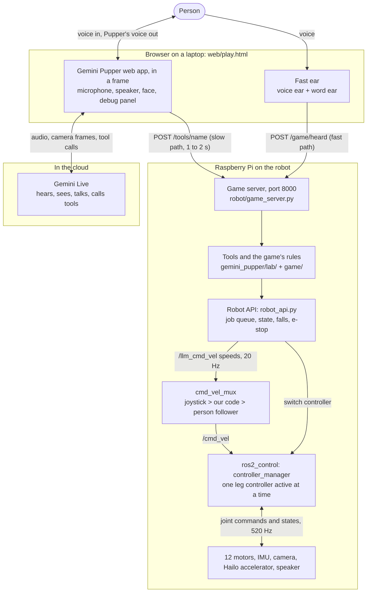
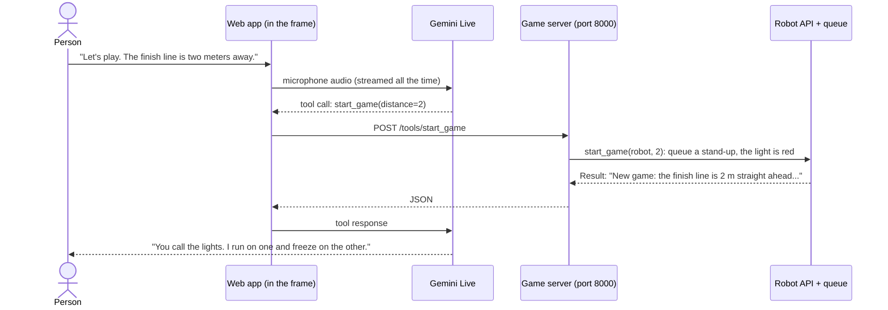
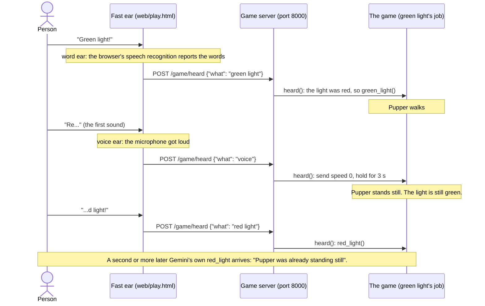
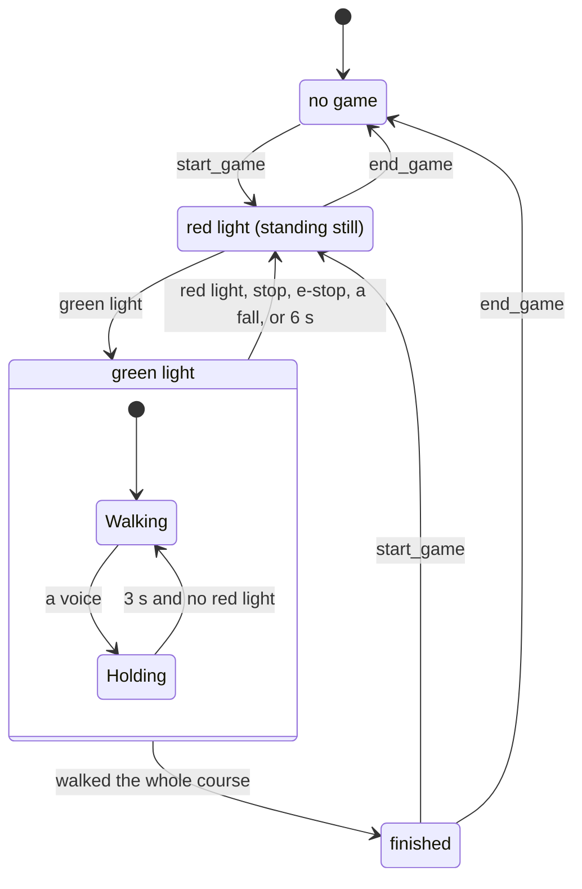

# How Pupper works, and how to build on it

This is the map we work from in the final project. It covers the robot from the
motors up to Gemini, which lab taught which layer, how our game sits on top, and
how to use each part from our own code. Paths like `gemini_pupper/...` are the
lab repos next to this one in `~/labs/`.

## The layers

Each layer only talks to the one below it. Our project lives in the top three:
the page, the tools, and the game's rules.



| Layer | What it is | Where we met it |
| --- | --- | --- |
| Hardware | 12 motors, three per leg, named `leg_{front,back}_{l,r}_{1,2,3}`. A Raspberry Pi, an IMU, a fisheye camera, a Hailo accelerator for neural-network vision, a screen, a speaker, a gamepad. **Our Pupper has no microphone.** | every lab |
| Joint control | `ros2_control`: one `ros2_control_node` (the controller manager) owns the motors. Broadcasters publish `/joint_states` and `/imu_sensor_broadcaster/imu`. A `forward_command_controller` passes our own torques or joint positions straight through. | `pd_control_lab` (torque on one joint), `forward_kinematics_lab`, `ik_heuristic_walking_lab` (positions on all 12) |
| Walking | A `neural_controller`: a trained policy that runs inside the controller manager and turns a speed command (`/cmd_vel`: forward, sideways, turn) into joint targets. Several are loaded; exactly one holds the legs. | `pupper_gait_deploy` (and the gamepad: X, circle, triangle, square pick a policy) |
| Seeing | The camera publishes `/camera/image_raw/compressed`. YOLO on the Hailo finds people; a state machine turns "where is the person" into speeds. | `follow_me_pupper` |
| Tools | Python functions Gemini can call, and the checks that make them safe. A queue runs them one at a time. | `gemini_pupper` (lab 6) |
| Brain | Gemini Live, reached from the browser. It hears, sees and talks, and it can only act by calling a tool. | `gemini_pupper` |
| The game | The rules of red light, green light on top of the tools, and a page that hears the lights faster than Gemini can. | this repo |

## Who does what in the game

Gemini was the whole brain in lab 6. In this game it turned out too slow for the
one thing that has to be quick, so the work is split three ways:

| Part | Where it runs | Its job |
| --- | --- | --- |
| **Gemini** | the cloud, through the web app | Pupper's voice and personality. Understands free speech: starts and ends games, takes the course length, answers "did you make it?", plays a victory trick. Works the lights only when the ear is not there. |
| **The fast ear** (`web/play.html`) | the browser, next to the app | Works the lights. The *word ear* (the browser's speech recognition) hears "green light" and "red light". The *voice ear* (how loud is the microphone) freezes Pupper at the first sound of a voice. |
| **The game's rules** (`game/red_light_green_light.py`) | the robot | Decides what counts. Keeps the score sheet, and refuses anything that would move Pupper on red, whoever asks. |

## Rules that follow from this design

- **One stack at a time.** Every lab's launch file starts its own
  `ros2_control_node`. Two of them fight over the motors. Stop one before
  starting another (`robot/stop.sh`); `robot/start.sh` reuses a stack that is
  already running.
- **Exactly one controller holds the legs.** The robot is always in one state:
  `locomotion` (the walking policy, controller `gemini_walk`), one trick (its
  `trick_<name>` controller), `motors idle` (nothing: Pupper lies down), or
  `fallen`. Changing state is one controller switch, `robot.switch_to(...)`.
- **Walking is a stream of speeds, not a command.** The policy walks only while
  it keeps receiving a speed. `cmd_vel_mux` forgets a source that is quiet for
  0.5 s, so a crashed program cannot leave Pupper walking. Our code sends the
  speed 20 times a second for as long as it wants to walk.
- **The joystick always wins.** `cmd_vel_mux` takes `/teleop_cmd_vel` (gamepad)
  over `/llm_cmd_vel` (our tools and the game) over `/person_following_cmd_vel`.
- **The e-stop is the gamepad's right stick, pressed.** It relaxes the motors
  whatever the software is doing. A second e-stop is automatic: a controller
  that tilts past its limit only damps the joints (a fall), and the robot
  refuses to move until a person sets it upright and `stand_up` is called.
- **Gemini learns about the world only from tool replies and camera frames.**
  A tool returns `Result(ok, message)`, and Gemini reads the message word for
  word. The robot cannot interrupt Gemini: if something happens by itself (a
  fall, a timeout, the ear changing a light), Gemini finds out at its next tool
  call.
- **The robot never hears audio.** The microphone and speaker belong to the
  browser. Robot code sees HTTP requests, not sound: tool calls from Gemini, and
  what the ear heard. Anything that reacts to sound has to run in the page.
- **Stopping is always allowed; starting has to be earned.** A stop is accepted
  from anyone at any time. A walk is only accepted when the rules say so, and
  only the words "green light" can start one: a noise never can.
- **Units and directions.** Metres, seconds, degrees. `+x` is forward, `+y` is
  left, and a positive turn is to the left (counter-clockwise).

## Two paths from a voice to the legs

**The slow path: through Gemini.** Everything Gemini does takes this path. Here
it starts a game:



Gemini waits until the person has finished speaking, thinks, and the call then
crosses the internet twice. That takes one to two seconds, which is fine for
starting a game and far too long for a red light: at 0.4 m/s Pupper walks most
of a metre on red.

**The fast path: the ear.** The page listens to the same microphone and tells
the robot directly, on the local network:



What we measured:

| | Result | How it was measured |
| --- | --- | --- |
| Word ear, compared with Gemini | heard "red light" 1.0 to 1.7 s before Gemini's `red_light` call arrived (three red lights) | on the real robot, from `server.log` |
| Voice ear | told the robot 45 to 100 ms after a voice began | a headless browser on the Pi playing a recording as its microphone, with a fake robot. A real microphone over the SSH tunnel will be a little slower. |

Four things keep the fast path honest:

1. **The robot decides what counts.** The ear only reports. A "green light" is
   taken only on red, a "red light" or a voice only on green, and with no game
   on nothing is.
2. **The ear and Gemini never both give a green light.** The page says
   "listening" every 2 s while the word ear is on. During that time Gemini's
   own `green_light` changes nothing: it arrives so late that the light may
   have turned red again, and walking then would be walking on red. Gemini's
   `red_light` and `stop` always work.
3. **Pupper cannot call its own light.** The word ear hears the speaker too. The
   page watches when the app plays Pupper's voice and ignores a "green light"
   until a second after it stops. The prompt also tells Gemini not to say the
   words.
4. **If the ear goes away, Gemini takes over.** Close the page, or use a browser
   that cannot recognise words, and within 5 s the robot lets Gemini work the
   lights again, slowly, as before.

## The game's state

`Game`, in `game/red_light_green_light.py`, is the score sheet: the phase, the
course length, the distance walked. Pupper has no way to know where it is, so
"walked" is the speed it was told to walk at, times the time it walked.



| Change | Gemini (a tool) | The ear (`POST /game/heard`) | The robot, by itself |
| --- | --- | --- | --- |
| start a game | `start_game` | (the New game button posts `start_game`) | |
| red to green | `green_light`, only while the ear is not listening | `"green light"` | |
| walking to holding | | `"voice"`, after the first 0.5 s of a green light | |
| holding to walking | | | 3 s with no red light |
| green to red | `red_light`, `stop` | `"red light"` | the gamepad e-stop, a fall, 6 s with no red light |
| green to finished | | | the whole course walked |
| end the game | `end_game` | | |

While a game is on, the lab's `move`, `turn` and `play_trick` are refused.

## How to use each part

All of these are used in `game/red_light_green_light.py`; the finished examples
to copy from are `gemini_pupper/lab/basics.py` and `part2_walk.py`.

**The Robot API** (`gemini_pupper/robot/robot_api.py`; the list is at the top of that file)

| You want to | Use |
| --- | --- |
| Do something that takes time (walk, a trick) | `await robot.queue(name, job, seconds, then=state)`: `job` is an async function that runs later, in order. What `queue` returns is what the caller hears now. |
| Walk | inside a job: `await robot.switch_to(LOCOMOTION_CONTROLLER)`, then `robot.send_speed(vx, vy, wz_deg)` in a loop with `await robot.sleep(1 / LLM_CMD_RATE)`, then `robot.send_speed(0, 0, 0)`. Or call the lab's `walk(robot, vx, vy, wz_deg, duration)`. |
| Stop now | `await robot.immediate_stop()`: clears the queue, cancels the running job, sends speed 0. Not queued. |
| Pause without ending the job | what a hold does: the job keeps running and sends speed 0 instead of the walking speed (see `green_light`'s job) |
| Stand up, lie down | `stand_up(robot)`, `lie_down(robot)` from `lab/basics.py` |
| Play a trick | `play_trick(robot, name)` from `lab/part4_tricks.py`; the tricks are the folders in `gemini_pupper/tricks/` |
| Follow a person | `await robot.set_following(True)` / `(False)` starts or stops the person follower (lab 5's, behind the `follow` tool in `lab/part3_follow.py`); `robot.following` says if it is on. It runs outside the queue, so every motion first calls `prepare_to_move(robot)`, which ends it. The game does not offer `follow` to Gemini. |
| Know the state | `robot.state_now` (right now), `robot.state_after_queue` (once everything queued has run), `robot.fallen`, `await robot.mode()` (in words) |
| Know that something stopped the robot | `robot.stops` goes up at every stop (the stop tool, the e-stop, a fall). The game compares it with the value at the green light: see `game_of`. |
| Wait, or read the clock | `await robot.sleep(s)`, `robot.now()`. Never `time.sleep`: it freezes the server, the stop tool included. |
| Get a camera frame | `robot.latest_image` (a one-slot queue holding the newest message from the camera topic), or `GET /camera/image` on the server, which undistorts it |

**Writing a tool** (something Gemini can call). Every tool has the same two
halves, in this order:

```python
async def my_behavior(robot, ...) -> Result:          # what the robot does
    # 1. NOW: check the request; refuse with a reason AND the limit or the real choices
    async def job() -> Result:
        ...                                           # 2. LATER: check again, act, report
    return await robot.queue("name", job, seconds, then=LOCOMOTION)   # 3. what Gemini hears now

@tool("my_tool", "What Gemini reads to decide when to call it.",   # what Gemini reads
      speed=Param("number", "What Gemini reads about this parameter.", required=False))
async def my_tool_tool(robot, speed=0.4) -> Result:
    return await my_behavior(robot, speed)
```

Two habits from lab 6 that we keep: rules are enforced in the behavior, not only
written in the prompt; and a refusal says what was wrong *and* what would work
("a green light walks at 0.2 to 0.5 m/s, not 1.2 m/s"), so Gemini can recover.

**Reacting faster than Gemini** (something the page tells the robot). When a
tool call is too slow, the page can watch for the event itself and post it:

1. In `web/play.html`, detect it and call `tell('something')`. The page has the
   microphone; it could just as well watch a key, a button or the camera.
2. In `heard()` in `game/red_light_green_light.py`, add `'something'` to the
   words it knows, and decide when it counts. The page reports; the robot
   decides.
3. Nothing else: `POST /game/heard` in `robot/game_server.py` passes any word
   through. Add checks to `web/test_play.js` and `game/test.py`.

Keep the direction rule: an event that stops Pupper can be trigger-happy, an
event that moves it must not be.

**The prompt** (`game/prompt.md`) is who Pupper is and how it plays. It is sent
to Gemini when the app connects.

**The game server** (`robot/game_server.py`, port 8000) is the only door into
the robot. It is `gemini_pupper/robot/server.py` with two addresses added:

| Address | What it does |
| --- | --- |
| `GET /play` | our page: the web app in a frame, with the fast ear above it |
| `GET /` | the web app alone, as in lab 6 (no ear: Gemini works the lights) |
| `GET /tools` | the prompt and the tool list, for the app to hand to Gemini |
| `POST /tools/<name>` | run a tool. Gemini's calls arrive here; so do `chat.py --robot` and the New game button |
| `POST /game/heard` | what the ear heard: `{"what": "voice"}`, `"red light"`, `"green light"` or `"listening"` |
| `GET /camera/image`, `GET /system/mode`, `POST /stop/immediate` | a camera frame, the robot's state in words, stop now |

`PORT=8001 python3 robot/game_server.py --fake` runs the same server on a fake
robot, next to the real one: for trying the page at a desk.

**Vision of our own** (for later steps). Subscribe to
`/camera/image_raw/compressed` in a ROS node, or reuse the detector from
`follow_me_pupper/robot/` (YOLOv8 on the Hailo). The Hailo is held by one
process at a time. The stack's "follow me" service uses our lab 5 follower only
if it finds the repo at `~/follow_me_pupper` or `$FOLLOW_ME_DIR`; ours is at
`~/labs/follow_me_pupper`, so it falls back to the monorepo's person detector,
which runs all the time (see the last table).

## How this project plugs in

We do not copy Gemini Pupper. `robot/game_server.py` loads its server unchanged,
then adds our tools, our prompt and our page:

```
cs123_final_project/                       gemini_pupper/  (borrowed, not edited)
├── game/                                  ├── robot/server.py         the app + HTTP API
│   ├── red_light_green_light.py  ───────► ├── robot/tool_registry.py  @tool, Param
│   │     the rules, the tools, heard()    ├── robot/robot_api.py      queue, state, e-stop
│   ├── prompt.md                          ├── robot/test_tools.py     the fake robot
│   ├── test.py   (fake robot)             ├── robot/gemini_chat.py    Gemini in text
│   └── chat.py   (Gemini in text)         ├── robot/launch/           the robot stack
├── web/                                   ├── lab/                    our lab 6 tools
│   ├── play.html     the app + fast ear   └── web/dist/               the web app
│   └── test_play.js  its checks (node)
└── robot/
    ├── bootstrap.py     finds gemini_pupper, loads the game
    ├── game_server.py   server.py + the game, /play, /game/heard, --fake
    └── start.sh, stop.sh
```

Gemini gets the five game tools (`start_game`, `green_light`, `red_light`,
`game_status`, `end_game`) plus seven of the lab's (`stand_up`, `lie_down`,
`stop`, `robot_status`, `move`, `turn`, `play_trick`). The lists are at the
bottom of `game/red_light_green_light.py`.

## The work loop

| You changed | Then |
| --- | --- |
| `game/red_light_green_light.py` | `python3 game/test.py`, then `python3 game/chat.py`, then `robot/stop.sh && robot/start.sh` |
| `game/prompt.md` | `python3 game/chat.py`, then reconnect in the app (no restart) |
| `web/play.html` | `node web/test_play.js`, then reload the page (no restart) |
| `robot/game_server.py` | `robot/stop.sh && robot/start.sh` |
| a file in `gemini_pupper/lab/` | that repo's `python3 lab/test.py`, then ours, then restart |

Three ways to try things with nothing moving: `game/test.py` (fake robot, fake
time), `game/chat.py` (Gemini in text, fake robot in real time; it has no ear,
so there Gemini works the lights), and `game_server.py --fake` (the real page
and your real voice, on a fake robot).

## When something is wrong

| Symptom | Look at |
| --- | --- |
| `start.sh` hangs at step 1, or controllers fail to load | `/tmp/gemini-pupper/robot.log` |
| The app loads but Gemini has no tools, or a tool fails | `/tmp/gemini-pupper/server.log`: every tool call and its reply is there, and every time the ear changed something (`ear heard ...`) |
| Voice works, Pupper does not move | the debug panel in the app (each tool call and reply); `curl localhost:8000/system/mode` |
| Green light is slow again | Are you on `/play`, not `/`? The bar should say `word ear: on`. If it says `problem` or `not in this browser`, Gemini is working the lights: use Google Chrome and allow the microphone. |
| Pupper freezes at every noise | Turn **Sensitivity** down until the white line sits above the room's noise, or set **Freeze on** to the words. |
| Pupper does not freeze until the words are finished | **Freeze on** is set to the words, or the voice ear says `click anywhere to turn it on`. |
| Pupper stops a moment after a green light | Gemini's late `red_light` for the red light before it (two calls within about 2 s), or the voice ear heard something. `server.log` shows which. |
| Pupper refuses to move after a tumble | it is in `fallen`: set it upright and still, then ask it to stand up |
| Kiosk screen never wakes | `/tmp/gemini-pupper/kiosk.log`, `chromium.log`; the key in `~/.config/gemini-pupper/api_key`. The kiosk shows `/` (no ear), and our Pupper has no microphone, so play from a laptop. |
| The Pi is hot or sluggish | With the stack up we saw a load of about 8 on its 4 cores, mostly the camera and the monorepo's person detector (`hailo_detection`), which the game does not use. The launch file says it starts lab 5's quieter follower instead when it finds it: `FOLLOW_ME_DIR=~/labs/follow_me_pupper robot/start.sh`. We have not tried that yet. |
| What is each controller doing | `ros2 control list_controllers` |
